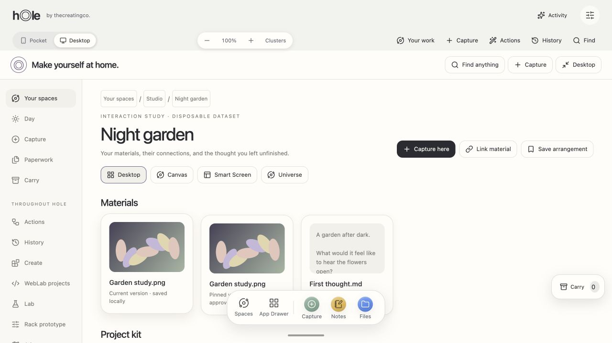
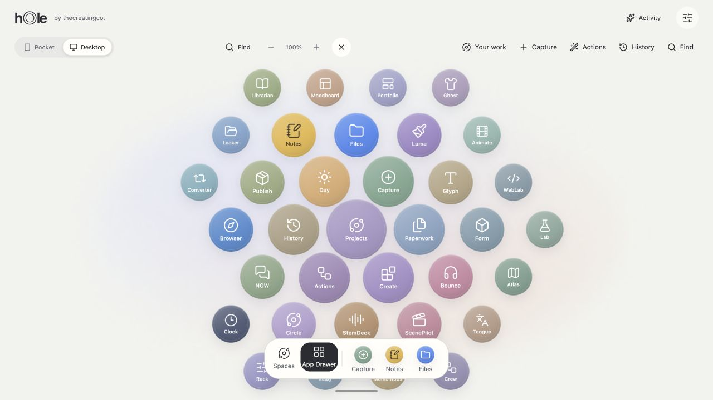
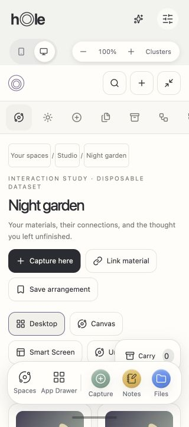

# Hole OS overhaul — review build qualification

26 October 2026. Source branch: `codex/hole-os-overhaul`; verified base: `7d98b7251718b5615196bad2c793554f8573b6b1`. The final commit is the branch revision containing this record. This is a substantial review build, not completion of the full master program. The [program ledger](../implementation/backlog.md) preserves required unfinished scope.

## Delivery

- [Netlify review build](https://6adfa58acfc5e0940a9e0685--hole-os-armonon.netlify.app/)
- Deploy ID: `6adfa58acfc5e0940a9e0685`; only `public/` uploaded to the existing Hole site as a draft deployment.
- Production `main` and the production URL were not replaced.
- [Deployment byte comparison](deployment-check.json) records every published file checked against the generated local output.
- The private Node collaboration service is a separate deployment. Its local QA data and credentials are not included in Git or the static site.

## Automated verification

Final source/build verification completed with **360 tests passing**, zero failed/skipped/cancelled. `npm run build`, JavaScript syntax checking and the authored-file whitespace check passed. Vendored upstream license notices retain their original trailing whitespace and are excluded from that style check. Node minimum is 22.13 to match the PDF engine. Source and generated public modules agree. Unused QuickJS runtime assets are omitted and vendor output is synchronized on build.

Tests exercise actual Core transactions and byte storage with fake-indexeddb, concurrent revisions, drafts, quota/interruption failures, atomic jobs, real local HTTP authorization/sync, packet-boundary bridge attacks, codecs, package state, gesture cancellation and offline update coordination. The real Luma engine has a separate [local qualification](luma-adapter-local.json); that transport was simulated, not a deployed connected editor.

One overlapping manual/dev-watcher build encountered a file-copy collision during QA. Stopping the watcher and running the final build serially completed successfully. Release commands should not run concurrently against the same output directory.

## Observed browser work

All checks used Codex's in-app browser with disposable content. Local origins were `localhost:5173`, `127.0.0.1:5173` and a fresh `127.0.0.1:5187`; they do not share origin storage. Hosted startup, project creation, drawer launch, recents and responsive layout were repeated at the final review URL. This is not a Safari/physical-touch/screen-reader certification.

| Journey | Actual result |
| --- | --- |
| Return to a thought | Changed the Night garden text, saved a draft, reloaded before committing, recovered the exact text and committed an immutable version. |
| Release artwork | Approved real focal-point previews/upscaling; generated three PNGs and downloaded the ZIP. CRC and image dimensions were inspected: 3000×3000, 1080×1920 and 1200×630. |
| Media | Imported a two-second H.264/AAC fixture; generated a browser video thumbnail and exported actual mono 44.1 kHz, 16-bit WAV lasting 1.999977 seconds. Persistent-player controls survived navigation; physical audible playback continuity was not qualified. |
| Rack | Rendered the actual OfflineAudioContext graph; downloaded a 5.45-second, stereo 44.1 kHz, 16-bit WAV with nonzero samples. This qualifies output rendering, not native plugin parity or physical audio-device behavior. |
| PDF | Drew a redaction over a known fixture phrase, reviewed the rasterization warning and exported. Parsing the output found one page, zero text items/annotations and no attachments. Private original retained. |
| Create | Counter state survived reload. Actual-Core regressions separately cover rapid edits, timer close, failure and draft races. |
| WebLab | Edited, previewed, versioned and reopened JavaScript. The sandbox denied parent DOM and localStorage access. Attempted frame self-navigation to an external test URL produced the browser's blocked-content page; the harmless test source was restored afterward. |
| Momentous | Installed the built-in counter v1, updated to v2, observed Add increase by five, rolled back and reopened v1 with saved state preserved. |
| Smart Screen | Previewed a release arrangement, explicitly applied positions and undid them successfully. File content/version policies remained separate. |
| Universe | Observed actual perspective/depth projection, camera controls and direct selected-material opening. No FPS benchmark or large-scene device qualification was performed. |
| Day | Saved a zoned event and linked task; both survived reload with the expected America/Los_Angeles time. |
| Relay | Signed into the local development service with a disposable QA account; uploaded eleven file versions, restored authorized copies as a separate project and signed out. Two HTTP clients cover offline/revocation/conflict behavior; two physical devices were not tested. |
| Full private backup | Downloaded a 24-asset / 26-version archive. Initialized a fresh browser origin, reviewed the starter-desktop replacement, restored it and observed the original task, event, note content and image materials. Personal-data conflicts stay strict; the current device identity is not cloned. |
| Offline entry | Stopped the `:5187` server and confirmed connection refusal with an independent HTTP request. Reload and a brand-new browser tab both opened the cached shell and restored Day/project content. This is server-unavailable evidence, not physical airplane mode. |
| Updates | An actual Update UI action reloaded an earlier cached version while preserving Day data. Subsequent edit-lock/cancel/timeout hardening passed harness tests; the complete multi-tab lock behavior still needs browser repetition. |
| Responsive drawer/workspace | At 320×720, document and main client/scroll widths were all 320px. Icon controls retained accessible names. The hosted circular drawer contains 35 local/external launchers; launching Day opened the actual local surface and added Day to the dock. |

Browser findings fixed during integration: PDF module MIME delivery; visible modal errors; native modal closing/focus ordering; an unclickable main surface after modal + whole-container animation (animation now targets the heading); save races; project breadcrumb/Space resolution; bootstrap backup collisions; phone overflow and hidden-label accessibility. The exact package update/open/close/rollback sequence passed after the animation fix.

## Downloaded byte evidence

Files below are disposable test outputs in the local Downloads folder. Full private backups and service data are intentionally excluded from this repository.

| Output | Bytes | SHA-256 |
| --- | ---: | --- |
| Release ZIP | 3124822 | `fd5ce056af56cbfec13dd0dfaf3efedcdb37893ed103371a6f951accf1325616` |
| Extracted WAV | 176442 | `6d333064dc80e57239aaa725524be831e960d182e3e7c76c3ec5d65f2a6faec0` |
| Redacted PDF | 13814 | `6cd25968f1c735380a4a57637258e08c7aa2d9908a88afcbb98021c6b5fe601c` |
| Rack WAV | 961424 | `7c43509402702e20eef0d07c442a9339fd35e38ba58a80a81a6f8aaa5ba9df6a` |

## Visual evidence

These are screenshots of the final hosted review build, not design mockups. The project is explicitly labeled as a disposable interaction study.

## Required work still open

See the full [46-row capability and acceptance ledger](../implementation/backlog.md). Major unfinished work includes platform-wide resizable runtime/editor continuity; richer Flow/Carry/Time/Publish and memory interactions; mounted retained-studio bridges and parity; missing segmentation/stems/key-BPM/transcription/video-trim engines; full Relay/shared-World/social-provider UI and production hosting; deeper Lab/package/Browser/Atlas/Tongue capabilities; Vault implementation/security review; physical-device/accessibility/performance qualification and actual formative research. These remain required where the master brief says so. Only the brief's explicit future items, including native remote application execution, are labeled future.

## Continuation qualification — 26 October 2026

This continuation adds actual mounted Luma engine controls and native recovery, multi-step Flow/audio-inclusive release archives, Carry snippets/pinned handoff, line diffs, cross-Space project references, arrangement runtime references, lazy Universe previews, Lab instruments, optional memory, Day recovery, Browser Trails and Relay conflict/audience controls. It does **not** complete the master brief or supersede outstanding gates above.

Local evidence on macOS arm64 Apple M4, installed Chrome 155.0.8059.85:

- `scripts/verify-continuity-browser.mjs`: actual shell pinned Carry link; snippet ACK/reload; text diff; place search; cross-Space project visit; snapshot schema 2; multi-step Flow authoring; Carry → real image conversion → selected-version Publish export; 320px reduced-motion no-overflow. Zero page errors. A 200-item Universe attached at most 30 spatial holders, all 200 reachable in list mode, observed mount 33–40ms. This is a local headless sample, not a physical-device performance claim.
- `scripts/verify-luma-browser.mjs`: real engine PNG crop/save/original bytes, native `.luma` opacity edit/recovery/save/reopen, sandbox parent/localStorage/IndexedDB/top-navigation denial and revoked reads. `scripts/verify-luma-shell-browser.mjs`: actual workspace Open in Luma, crop/save, minimize/resume, close/reopen and loaded phone layout.
- `scripts/verify-lab-memory-browser.mjs`: actual signal edit/ACK/reload and WAV 48kHz/48,000 frames; invalid frequency rejection; generative PNG 640×360; pendulum saved samples; memory enable/pinned-source/save/reload/correct/JSON-export/exclude/disable/forget; disabled write refusal. Zero page errors.
- `scripts/verify-relay-browser.mjs`: two disposable persistent profiles, real offline failure, close/reopen queued conflict, deliberate resolution and other-profile pull; actual mounted guest create/review/revoke controls; anonymous pinned bytes exclude later private content and fail after revoke.
- `tests/verify-everyday-browser.mjs`: actual event create/delete/reload/restore, contact delete, exported recovery bytes, actual query URL and saved project Trail. External search response intercepted; no assertion about the provider's response.

Browser scripts use disposable localhost fixtures; no actual user data is sent or published. Set `HOLE_PLAYWRIGHT_MODULE` to an installed Playwright module for general scripts; Luma scripts document their tooling environment variables. Full Node suite count is recorded in the checkpoint. Remaining production/provider, studio-parity, physical Safari/touch/audio/assistive-technology and human-research gates remain open. The latest review deployment must be recorded separately from local verification.
