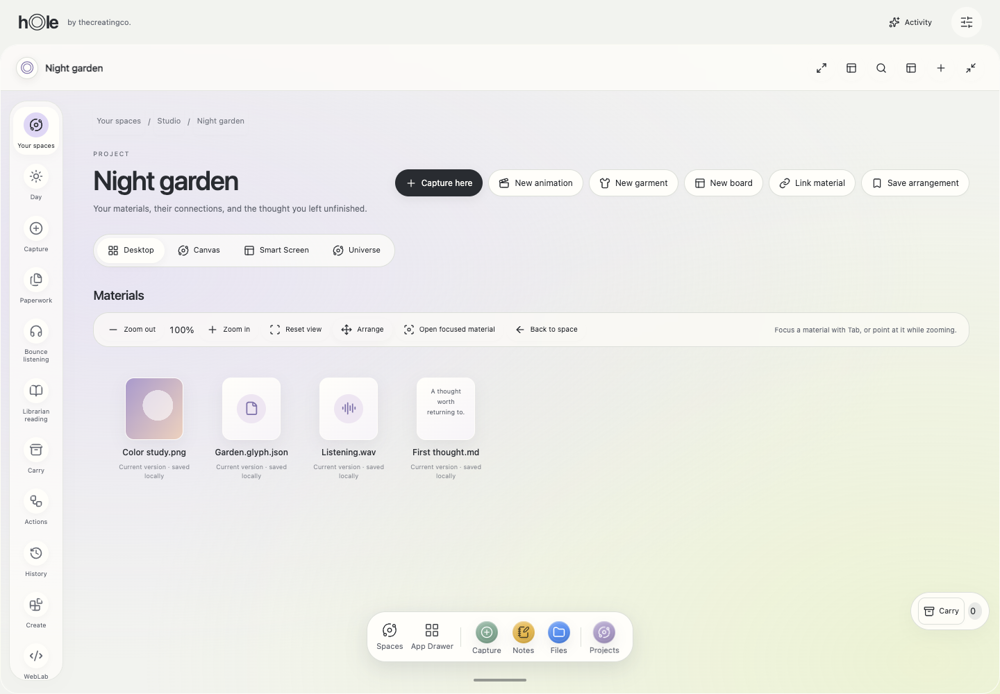
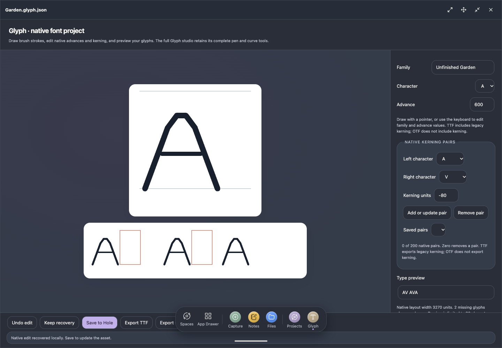
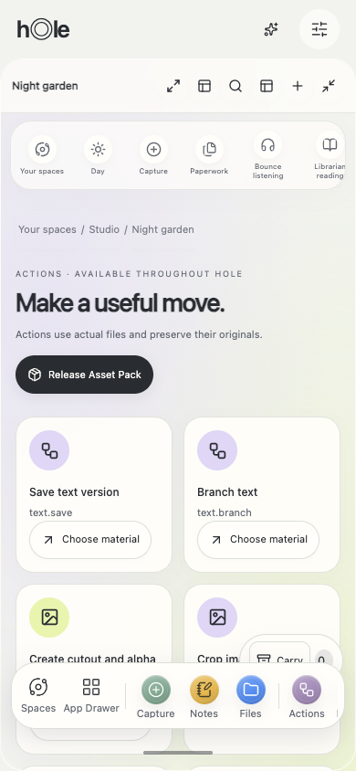

# Visual overhaul — 28 October 2026

The shared visual language now reaches working project desktops, canonical applications and seven connected native editor interiors. This increment builds on the existing circular shell, drawer and workspace manager; it preserves file identity, versioned actions and recovery. It does not complete the entire master program.

| Surface | Delivered behavior | Evidence |
| --- | --- | --- |
| App Drawer and circular manager | Existing bubble movement and circular manager retained; running editor foreground/inert handling and actual runtime dock recents unified. | Drawer over fullscreen dirty Glyph; same instance resumes from dock. |
| Project desktop | Small upright material icons, actual saved placement by drag or keyboard, pan/zoom, tap and hold focus; circular project previews. | Durable placement, cancelled drag rollback, touch single-open and long-press tools. |
| Semantic travel | Desktop camera separated from Canvas and compact layout; existing pinned semantic zoom, anchors, hysteresis and overview return retained. | Semantic browser journey and desktop movement check. |
| Spatial stage | Universe fills the app stage with floating navigation, camera controls and reachable List alternative. | Real project materials; >650px stage; phone/desktop layouts. |
| Motion | Shared easing, object-to-preview departure, heading arrival, decorative dock folding and cancellable input. Quiet/reduced settings stop animation and propagate into running editors. | Preference toggles, interruption, live iframe quiet/dark updates. No live iframe is cloned. |
| Windows and dock | Shared float/drag/resize/fullscreen controls; keyboard geometry dialog; native editor drag and viewport clamping. Fullscreen minimal dock, hover and 10/30/50 upward travel. | Actual pointer journeys; refused checkpoint retains live editor; same dirty instance resumes. |
| Welcome and widgets | Local activity/control entry, motion/layout switches, explicitly revealed recent local work with Hide. | Titles absent before reveal; reveal/hide and working preference controls. Welcome remains a public start surface. |
| Contextual tools | Anchored rounded action strip and phone sheet; Convert/resize, stems and media actions route to existing supported processors with selected-version validation. | Right-click and stationary emulated long-press; single-click still opens. No processing runs merely by opening tools. |
| App interiors | Shared rails, fields, dialogs and spacing; native studios use actual work surface, inspector and save/status footer. Theme updates without remount. | Seven trusted editor hosts themed; native save/recovery regression scripts. |
| Phone and accessibility | Horizontal navigation and toolbars, disclosed project tools, viewport-clamped menus, 320/390px layouts and reduced motion. | 15 canonical surfaces; native editor at320px; 400% browser zoom journey. |

## Verification

- `npm run build` generates the static shell and all assets; `npm test`: **660 passed, zero failed/skipped**.
- `scripts/verify-visual-os-browser.mjs`: actual generated shell, disposable project with PNG/WAV/Glyph/text bytes; private reveal, placement, pointer cancellation, emulated touch, workspace geometry, contextual strip, live editor theme, dock gestures, refused checkpoint, foreground drawer, dirty resume, Universe and phone layouts. Zero page errors.
- 25 existing browser regression scripts were run against generated assets. Accessibility initially caught an out-of-viewport project menu at400% zoom; anchoring and scroll bounds repaired it and the replay passed. Continuity and semantic journeys were replayed after the final camera change.
- Regression coverage includes tool windows, Luma selection/exports, Glyph kerning, Form seams, ScenePilot split, StemDeck transport, library collections, Relay, optional memory, packages, WebLab, Tongue, Publish, window checkpoint, extension unload, text recovery and close guards. Receipts are summarized in the adjacent JSON.
- Actual browser images below are disposable fixture work, not design mockups. Screenshot capture hides the intentionally injected checkpoint-refusal toast; the assertion still verifies its behavior.

## Practical limits

Canonical apps share one resizable workspace; independent simultaneous instances for every app remain a runtime requirement. The connected native editors remain bounded implementations alongside retained original studios, with feature parity still open. Universe uses CSS3D; rich furniture and physics remain future scope. Physical touch/audio, screen readers, measured contrast/performance, Safari and human research require their actual devices and participants. Browser-emulated touch is not physical-device certification.

This increment adds no production backend, account sync, social provider or native Windows/macOS/Linux execution. Local browser data stays origin-specific. Production delivery and the exact public-file byte receipt are recorded below.

## Initial delivery attempt — historical

Implementation `04ddc38` is pushed to `codex/hole-os-overhaul`, PR1. The425-file frozen public snapshot is recorded in [delivery receipt](review-04ddc38.json). Netlify accepted review deployment `6ae233650ed57be37ce8feda`, but it remained preparing; its preview returned HTTP500, while the existing production URL returned HTTP503 `usage_exceeded`. Hosted verification could not run. The CLI wait was stopped; no production promotion occurred. Restoring Netlify usage allowance is required for a working hosted preview. The tested build remains available locally on port5193 and through `npm run dev` on5173.

## Production delivery — restored hosting

After the owner restored Netlify allowance and requested the latest push, `c0dd763` was deployed to [the main Hole OS site](https://hole-os-armonon.netlify.app/), deploy `6ae23610b58e94ea5ddaf3ca`. The generated-shell visual browser journey passed against that actual production URL with zero page errors, including15 app surfaces at320/390px. The [production byte receipt](production-c0dd763.json) records static-file and worker-header verification; the adjacent production browser receipt records interactions. Full-program limitations above still apply.
